# Stage-only endpoint, checkpoint by checkpoint

**Endpoint:** one green/black stage (what fullscreen is today). No wood page, no Fullscreen mode, no four-column sliders on screen. Audio/MIDI/automation read a JS param store whose keys are today’s IDs (`cutoff`, `osc-tune-0`, …). `#synthContainer` is gone.

**Hard rules:**

- Do not make any `kb*` node the engine’s source of truth.
- Do not delete `#synthContainer` until checkpoint 9.
- Finish a checkpoint’s tests before the next. Fail = stop.
- After checkpoint 3, play the instrument in real use before checkpoint 4.
- **Normalize the entire `?v=` import graph before any other JS change.** Live skew: `knobs.js` 100\|106\|111, `midi.js` 83\|85, `berlin.js` 33\|34, `pitch-bend.js` 81\|82, `keyboard-acid-strip.js` 9\|10. Import-string-only edits in engine files are allowed for this step; do not change engine logic.
- Do not use `inert` on the param bus. Use `hidden` + `aria-hidden`. Verify `.click()` on hidden `#filterEnvToggle` in Chrome, Safari, and Firefox.
- **Never put Keyboard Off inside `#keyboardControlsFieldset`, the MIDI logo row, or `.keyboard-toolbar-top`.** Controls is collapsed. MIDI lives in `#midiFieldsetHome` until JS moves it, so Off in that row can sit **under** the fixed stage on first paint. `.keyboard-toolbar-top` is already `display: none` in `keyboard-stage-mode` (`styles.css` ~2146) — Off is **already invisible in today’s fullscreen**. Put Off next to `#kbStartStop` in `.keyboard-tempo-div-row` (inside `.keyboard-section` in the **HTML**, not after `initKeyboard`).
- **Off hides piano + computer-keys + chromatic spacebar only.** Transport, synth knobs, steps, MIDI, and **XY stay**. Do not also say “XY follows keyboard visibility.”
- Tests that can **false-pass:** inspector `#steps` × 32; `.click()` matrix; “Start works” via hidden `#startStop`; map-select highlight with no CC apply; Fullscreen/Escape with CSS locked but `state.keyboardFullscreen` still gating XY/spacebar; Off present in the DOM but still inside `.keyboard-toolbar-top`; MIDI present in the DOM but still in `#midiFieldsetHome` (under the overlay until JS).

```mermaid
flowchart LR
  cp1[CP1 stage is the page]
  cp2[CP2 MIDI learn]
  cp3[CP3 drop fullscreen]
  gate[Play in real use]
  cp4[CP4 param facade]
  cp5[CP5 engine reads]
  cp6[CP6 osc keys]
  cp7[CP7 live steps]
  cp8[CP8 widgets write]
  cp9[CP9 catalogs then delete]
  cp1 --> cp2 --> cp3 --> gate --> cp4 --> cp5 --> cp6 --> cp7 --> cp8 --> cp9
```

Reviews: [first](e894934f-ab43-45d6-bf11-c583f14eb016), [second](662c3a5a-6e06-4a38-8045-134b8375d682), [third](3fbc585c-030e-450a-89ba-9a6966dfee17). Fourth: bindSteppedKnob / LFO RATE / `.is-fullscreen` CSS / sr-only `h1`. Fifth: MIDI in `#midiFieldsetStage` in HTML; rewrite `.keyboard-off`; pitch-bend + LFO-amount + dial-reset. Sixth: Off is already hidden in fullscreen (`.keyboard-toolbar-top { display: none }`); CP1 steps 2+3 and 2+4 are pairs (do not ship one without the other); selects are not in `setupMappingListeners`; Ingy-6 faders + ADSR canvas need the same mapping short-circuit as knobs.

---

## Shared test kits

**Boot:** hard refresh. No red console. Green/black stage, piano, transport, oscilloscope. Start plays. No wood, even for a frame.

**Core play (~5 min):** Start/Stop (toolbar + piano spacebar). Hold key; Latch. Tempo/division/steps while playing. Write 8 steps (note, rest, acc, sld, ratch). Cutoff/res/vol. Osc 1–4 on/off + wave. OSC4 analog/digital. Master tune/octave.

**Full instrument (~20 min)** — gates after 1, 3, 5, 7, 9:

- Acid strip; FX; amp + filter ADSR (knobs and VFD drag); LFO (Hz/sync, dests, retrig, amount strip)
- Unison / phase reset / ring / noise
- Pattern bank copy/paste/clear; pattern shift
- Berlin on/off; Poly / chord mem; Multitudes / Ingy-6 enter-tweak-exit
- Automation rec one loop on cutoff, playback, undo, clear
- XY two axes + None
- MIDI notes; Mapping (in-session only — maps are **not** in localStorage)
- Computer-keys vs chromatic
- Keyboard Off: toggle still on screen **without opening a collapsed panel**; piano/computer-keys/spacebar hide; **transport/Start/knobs/XY stay**; stage stays `#050805`; On restores piano
- Phone: no wood, no swipe-dot paging, arrows must not steal keys for section swipe
- Console clean

**Regression tell:** UI moves, sound does not (or the reverse) = mirror/store split.

---

## Checkpoint 1 — Stage is the page (do now)

**Goal:** The product is the current fullscreen stage. Columns exist in the inspector, never on screen.

**Do, in this order:**

1. **Normalize every `?v=` import to one version per file** (grep the whole `js/` graph, including `pitch-bend.js` and `keyboard-acid-strip.js`). This is not cosmetic: `main.js` side-effect-imports `midi.js?v=85` while `controls.js` uses `?v=83` (two MIDI module instances); `berlin.js` 33 vs 34 and `keyboard-acid-strip.js` 9 vs 10 fork live audio helpers. Import-string-only changes in engine files are allowed here; no engine logic.
2. **Change Keyboard Off semantics first.** `syncVisibilityUI` currently `display:none`s `.keyboard-filter-knobs` (contains `#kbStartStop`), pitch bend, and `#keyboardControlsFieldset`, plus steps via `syncKeyboardStepsVisibilityWithKeyboard`. Off must hide **only** the piano, computer-keys board, and chromatic spacebar. Leave transport, synth knobs, steps, MIDI, XY, pitch bend. Stop calling `setKeyboardFullscreen(false)` (that also runs `syncMidiFieldsetSlot(false)` and teleports MIDI back under the overlay).
3. **Move `#keyboardVisibilityToggle` next to `#kbStartStop` in the HTML** (`.keyboard-tempo-div-row`). That row is already Start, Rev, Tempo, DIV, STEPS, DISP — use a compact `kb-step-btn`, not a wide `.pushable`, and smoke **phone wrap**. **Do not leave it inside `.keyboard-toolbar-top`** — `body.keyboard-stage-mode .keyboard-toolbar-top { display: none }` (`styles.css` ~2146). Do **not** put it in Keyboard Controls or the MIDI logo row. **Pair with step 2:** moving Off into `.keyboard-filter-knobs` while Off still `display:none`s that row makes Off hide itself.
4. **Put `#midiFieldsetHome` inside `#midiFieldsetStage` in the HTML** (not an empty slot filled after `initKeyboard`). Today it sits above `.keyboard-section`; a CSS-default fixed stage covers it until JS runs — first paint has no MIDI. **Pair with step 2:** HTML-stage MIDI + leftover Off→exit-fullscreen still teleports MIDI under the overlay.
5. **Default the stage in CSS/HTML.** `body { background: #050805; padding: 0; overflow: hidden }` and drop the wood URL in the **same** CSS change. Make `.keyboard-section` use current fullscreen rules (`position: fixed; inset: 0; overflow-y: auto; …`) as default. Put `keyboard-stage-mode` / `is-fullscreen` on the markup. **Rewrite `.keyboard-section.keyboard-off`** (`styles.css` ~2224): it currently sets `background: transparent; padding: 0` because Off used to dump you onto wood with knobs hidden. If Off keeps transport/knobs, that rule will crush remaining chrome. Hide piano/ckb/spacebar only. **One title rule:** sr-only `h1` (add the CSS). Lift **all** `.is-fullscreen` rules: piano (~2204), `.legend-hex` (~2356), spacebar (~2656), computer-keys board (~7987), XY (~3174). Bump `styles.css?v=` and `js/main.js?v=` in [`index.html`](index.html). Optional: `100dvh` + safe-area.
6. **Hide, do not inert, the bus:** `.header-grid`, `#mobileStartStop`, swipe dots, `#synthContainer` → `hidden` + `aria-hidden`. Do not hide the sr-only `h1`.
7. **Lock Fullscreen and Escape as true no-ops in CP1** — including `state.keyboardFullscreen`. Dead Fullscreen button in collapsed Controls until CP3 is fine.
8. Ungate JS: `whiteKeyPx()` always 52; spacebar follows keyboard visibility (Off hides it); XY stays unless its own `[hidden]`; MIDI always in stage slot (and already there in HTML).
9. **Disable [`js/mobile.js`](js/mobile.js) swipe and the document `ArrowLeft/Right` `preventDefault`** (≤768px).

Engine **logic** stays untouched (import `?v=` strings excepted).

**Done when:** First paint is green/black, no wood. Off is beside Start, not under the overlay. Off hides piano/spacebar only; Start and XY stay. Escape and Fullscreen change nothing (including XY). Inspector still has `#synthContainer` and 32 `#steps` children.

**Smoke:**

- Boot + core play; first paint has no wood
- Keyboard Off / On **without** expanding Keyboard Controls; Start and XY still visible while Off; Off must **not** zero stage padding (rewrite `.keyboard-off`); Off must **not** be a child of `.keyboard-toolbar-top`
- Fullscreen **and Escape**: zero layout / MIDI-slot / XY / spacebar change
- First paint: MIDI visible on the stage (not waiting for JS relocate)
- Space with Off: still starts/stops (global Space in `controls.js` when `keyboardVisible` is false)
- Programmatic click: Poly on (`filterEnvToggle.click()`), acid, chorus I, stage Acc/On
- Phone: `#kbStartStop`; arrows adjust knobs, do not swipe
- Tab: hidden column sliders not focused; stage dials are
- XY: can assign `cutoff`; default is not `kbWriteFineProxy`
- Inspector: `#steps` has 32 fieldsets (necessary, not sufficient)

**Real-world:** 10–15 min bassline + filter ride. Phone once.

---

## Checkpoint 2 — MIDI learn on the stage (do now)

**Goal:** Mapping works from visible stage widgets. Hidden ranges are not clickable.

**Do not** only wire `KNOB_BINDINGS`. That misses LFO RATE ([`js/lfo-rate.js`](js/lfo-rate.js)), osc tune/vol ([`js/keyboard-oscillators.js`](js/keyboard-oscillators.js)), unison detune, write µtune, Berlin/MI knobs, delay-time **select**, and `.kb-step-btn` (not `.pushable`). `bindKnob` `pointerdown` already `stopPropagation` — a mapping `click` on the dial will not fire reliably.

**Do:**

- If `midiMappingMode`, `pointerdown` on a dial **returns before drag** (`bindKnob` always starts a scrub today). Otherwise learn also moves the param and can record automation.
- Store `state.currentMappingControl` / map `element` as the **canonical range or button**, not the dial. CC apply only writes `input[type=range]` ([`js/midi.js`](js/midi.js) ~279). A dial in that slot = silent CC.
- Highlight / `midi-mapped` on the visible `.synth-knob` or button. Today `.midi-mapping-active .control:hover` only styles main-column `.control` (`styles.css` ~995). Stage hosts will not show a learn affordance without new CSS. If the map `element` is a hidden range, both `midi-highlight` and `midi-mapped` are invisible.
- Exclude `#keyboardVisibilityToggle` from `setupMappingListeners` if it stays `.pushable`.
- Cover every `bindKnob` site **and** `bindSteppedKnob` (DIV) **and** LFO RATE (`js/lfo-rate.js` ~261) **and** pitch-bend strip (`js/pitch-bend.js` ~116) **and** LFO amount strip (`js/lfo-strip.js` ~267) **and** Ingy-6 fader slots (`js/keyboard-ingy6-panel.js` ~87) **and** ADSR canvases (`js/visualizers.js` ~457). Strips/canvas/faders are not `.synth-knob`; decide a canonical key or mark unmappable — do not silently fail (learn must not also scrub). `attachDialReset` also listens `pointerdown` capture (`js/knobs.js` ~132); mapping mode must not double-tap-reset.
- `.kb-step-btn`: map to the mirrored main pushable, or label unmappable — do not silently fail.
- **Selects (`#delayTime` / `#kbDelayTimeSelect`, noise type, unison voices):** not in `setupMappingListeners` today (only `input[type=range]` and `button.pushable`). CC apply also has **no select branch**. Cheap CP2: mark unmappable. Do not add learn-highlight on a select that a CC cannot change.
- Maps are in-memory only. No reload test.

**Done when:** Mapping highlight is on the widget; a CC moves that **sound**; the knob does not scrub while learning.

**Smoke:** Map cutoff, volume, ADSR, LFO rate, one osc vol, delay **toggle**. Confirm the dial does not move during learn. If delay **select** is in the smoke list, a CC must change delay time audibly — otherwise skip it. Mapping off. Remap. No reload.

**Real-world:** One hardware controller session in this page lifetime.

---

## Checkpoint 3 — Fullscreen mode goes away (do now, after 1+2)

**Goal:** No Fullscreen button, no Escape-to-exit, no MIDI home/stage swap.

**Do:** Remove the Fullscreen button and leftover listeners. Collapse dual CSS **without** dropping `.keyboard-section { overflow-y: auto }`. Drop `WHITE_KEY_PX_NORMAL`. **Keep** Escape for speech-rec, pitch-bend center, LFO strip zero.

**Done when:** Those product controls are gone. Off still hides **piano + computer-keys + spacebar only** (same as CP1), not the whole performance row.

**Smoke:** Boot + core play. Escape does not change layout; speech modal still closes; bend/LFO-strip Escape still center/zero. No Fullscreen button. No wood flash. Off stays on `#050805` with Start still visible.

**Real-world:** Full instrument kit. Then **stop coding.** Use the synth for real before CP4.

---

## Checkpoint 4 — Param store facade (later)

**Goal:** `js/params.js` `get` / `set` / `subscribe`. Keys = current IDs. `get` reads hidden input; `set` writes it and **`dispatchEvent('input')`** so live AudioParam rides in [`js/controls.js`](js/controls.js) (`cutoff` → `updateFilterCutoffRange`) still fire. **Equality-guard `set`** (no event if value unchanged) so knob `input` → `set` → `input` cannot loop. Engine files unchanged.

**Done when:** Stage cutoff moves `#cutoff` in the inspector and `params.get('cutoff')` matches, and filter still moves **while the sequencer is running**.

**Smoke:** Boot + core play. Ride cutoff during playback. Hidden `#cutoff` tracks.

**Real-world:** Same patch before/after must sound identical.

---

## Checkpoint 5 — Engine reads the store (later)

**Goal:** Voice / sequencer envelopes-tempo-gate-slide-accent / audio-engine / `getGlobalTune` / acid-env / unison / osc-source / filter-* / lfo-rate use `params.get`. Writers still DOM. **Not** the step grid.

**Smoke:** ADSR and filter env on a held note; cutoff/res/HP idle **and playing**; tempo vs delay time; master tune mid-pattern; acid decay/accent; unison; LFO Hz and Sync; volume/distortion.

**Real-world:** Full instrument kit. Listen for clicks, stuck notes, cutoff that only updates on the next step.

---

## Checkpoint 6 — Oscillator slots (later)

**Goal:** Keys `osc-tune-0` … (MIDI’s existing strings). No live `.osc-tune[data-osc]` on the audio path. Fold into `state.oscStates` / `state.oscTunes` — do not grow a third copy. Stage pan must still feed the same keys `unison.js` `readOscPanValue` uses today (main `.osc-pan`).

**Smoke:** All four oscs on/off, waves, tune, pan, vol; OSC4 digital spot-check; unison stacks on oscs; poly mute osc 2; acid strip constraints; Ingy-6 / Multitudes enter/exit restore.

**Real-world:** Osc 1+2 detune patch → poly → back. Osc 2 must not stick.

---

## Checkpoint 7 — Live steps (later; largest functional cut)

**Goal:** `pattern.steps[]` is what plays. Stop generating `#steps`. Isolated diff — not mixed with 5 or 6. Berlin lanes stay their own data. Sequencer look-ahead is ~100ms (`scheduleNextStep` / `playStep`); snapshot step data at **schedule** time so a bank edit mid-bar cannot play a torn step.

**Smoke:** Empty vs all-on; write pitch/rest/acc/sld/ratch/µtune; step count 1/8/16/32; reverse; shift ±1; bank copy/paste/clear; VFD names match audio; scale quantize.

**Real-world:** A 16-step line you care about, across slots, **in this page lifetime** (pattern bank is memory-only, like MIDI maps — reload is not a persistence test). Berlin still follows gate/pattern.

---

## Checkpoint 8 — Widgets write the store (later)

**Goal:** `bindKnob(dial, paramKey)`; buttons `params.set`. No `mainBtn.click()`. Delete [`js/control-mirror.js`](js/control-mirror.js). Stage / acid / MI share keys.

**Smoke:** Cutoff from stage, acid, and MI is one value; all FX toggles; chorus I/II; delay select; LFO on/retrig/sync; filter env / acid (former `.click()` paths); double-click reset; Keyboard Off does not desync.

**Real-world:** Full kit with acid and Multitudes in one session.

---

## Checkpoint 9 — Catalogs, then delete the ghost (later; point of no return)

**Inside this checkpoint, in order:**

1. XY explicit catalog (not `querySelectorAll('input[type=range]')`) — already polluted by `kbSlideTime`, `kbWriteFineProxy`, etc.
2. MIDI learn + playback by param key; aliases for old IDs.
3. Automation hosts from a registry, not `.closest('.control')`. `RANGE_IDS` keep `lfoSpeed` and `lfoSyncDivision` coherent with sync mode.
4. ADSR canvases: kb IDs only, store-backed.
5. Oscilloscope: `#kbOscilloscope` only (today both canvases are painted every frame).
6. **Null-safe transport before delete:** [`js/sequencer.js`](js/sequencer.js) `togglePlay` does `mobileStartStopButton.querySelector('.front')` with **no** `?.` — deleting `#mobileStartStop` or `#startStop` throws on Start. Fix that first.
7. Delete `#synthContainer`, header scope, swipe dots, `#mobileStartStop`, [`js/mobile.js`](js/mobile.js). **Keep** the sr-only `h1`. Remove facade DOM sync. Null-safe [`js/controls.js`](js/controls.js) `mobileStartStopButton.addEventListener` (~151) as well as `togglePlay`. `controls.js` must not attach to missing classic IDs.
8. Grep: zero duplicate `?v=` in the import graph.

**Smoke after delete:** No null TypeError; inspector has no `#cutoff` / `#steps` / `#startStop`; full kit; old in-session maps if still open; XY list sane; automation playback; phone.

**Real-world:** Long write session, hard refresh, second device. If boot fails, revert **this checkpoint only**.

Pitch bend, latch, held notes, Berlin lanes, speech modal, computer-keys are not `#synthContainer` params — they must still work after delete, but they are not store keys unless a later pass says so.

---

## New features

- After CP3: stage widget + `state.js` (hidden input only if engine still `getElementById`s it).
- After CP4: stage widget + `params.set` / `get`.
- Never add UI back into the four columns.
