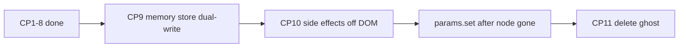

# Stage-only endpoint, checkpoint by checkpoint

**Endpoint:** one green/black stage. No wood page, no Fullscreen mode, no four-column sliders. Audio/MIDI/automation read a **JS** param store whose keys are today’s IDs (`cutoff`, `osc-tune-0`, …). `#synthContainer` is gone.

**Where we are (2026-08-16):** CP1–9 done. CP10 is implemented (one engine path via `params.subscribe`; `params.set` does not `dispatchEvent`/`click` classic nodes). Ghost HTML still in the page. **Smoke CP10 before CP11.** Do not delete `#synthContainer`.

**Why the old CP9 was unsafe:** it listed catalogs, then “remove facade DOM sync” and **delete `#synthContainer` in the same checkpoint**. Today the facade **is** the ghost DOM. Delete first and boot throws: [`js/controls.js`](js/controls.js) ~1914–2034 attaches to `#stepCount` / `#tempo` / `#cutoff` / … at **import time** (no `?.`). [`togglePlay`](js/sequencer.js) does `startStopButton.querySelector('.front')` with no `?.`. `wireControls` does the same for `#mobileStartStop` (~151).

**Hard rules (still in force):**

- Do not make any `kb*` node the engine’s source of truth.
- Do not delete `#synthContainer` until **checkpoint 11**, and only after CP10’s proof (`params.set` after the node is gone — leftover detached listeners do not count).
- Finish a checkpoint’s tests before the next. Fail = stop.
- If CP11 boot fails, revert **that commit only** — leave `5527e83` (CP8) intact.
- One `?v=` per file across the whole import graph. Do not bump `docs/`.
- Do not use `inert` on the param bus while it exists (`hidden` + `aria-hidden`).
- **Off hides piano + computer-keys + chromatic spacebar only.** Transport, knobs, steps, MIDI, XY stay.
- Parked (do not mix into 9–11): classic sequencer ratch stays on the private osc path (no unison, no shared filter env). Analog/digital UI lives on oscillator 1; code slot is still `OSC4_INDEX` — do not rename. **XY musical-only list** (drop slide/gate/accent/comp/etc.) is a later pass — CP9 only has to stop `querySelectorAll` and apply via `params.set`. **CP9 audio niggles** are not CP10 fails. **Hardware MIDI CC** is not a CP10 gate (`applyMappedCc` is already `params.set`; learn-by-key is the proof).
- Do not convert Poly / Ingy-6 / Multitudes **mode** entry into “param widgets” in CP9. After CP10 those mode helpers must `params.set` osc/chorus keys instead of clicking missing nodes.

Reviews (CP1–3 era): [first](e894934f-ab43-45d6-bf11-c583f14eb016), [second](662c3a5a-6e06-4a38-8045-134b8375d682), [third](3fbc585c-030e-450a-89ba-9a6966dfee17).

**Independent reviews of this CP9–11 split:** [first](2e46c4eb-718b-4f43-b3ad-5da792f1ca03) (detached ≠ present); [second](265b31be-6ff8-43c5-83e3-babd740b2c73) (automation **record**, MIDI learn without a live node, XY pointer/follow, step-knob bounds). **CP10-only:** [third](afe62281-14b7-4a19-9154-043276a131f0) (`flushDomToPattern` wipe; osc `querySelectorAll` no-throw; bind-at-boot; Rec `applying`; no classic `dispatchEvent`; `setLfoEnabled` recurse). Folded below.

---

## Shared test kits

**Boot:** hard refresh. No red console. Green/black stage, piano, transport, oscilloscope. Start plays. No wood, even for a frame.

**Core play (~5 min):** Start/Stop (toolbar + piano spacebar). Hold key; Latch. Tempo/division/steps while playing. Write 8 steps (note, rest, acc, sld, ratch). Cutoff/res/vol. Osc 1–4 on/off + wave. OSC4 analog/digital. Master tune/octave.

**Full instrument (~20 min)** — gates after CP8, CP10, CP11:

- Acid strip; FX; amp + filter ADSR (knobs and VFD drag); LFO (Hz/sync, dests, retrig, amount strip)
- Unison / phase reset / ring / noise
- Pattern bank copy/paste/clear; pattern shift
- Berlin on/off; Poly / chord mem; Multitudes / Ingy-6 enter-tweak-exit
- Automation rec one loop on cutoff, playback, undo, clear
- XY two axes + None
- MIDI notes; Mapping (in-session only — maps are **not** in localStorage)
- Computer-keys vs chromatic
- Keyboard Off: toggle still on screen **without opening a collapsed panel**; piano/computer-keys/spacebar hide; **transport/Start/knobs/XY stay**; stage stays `#050805`; On restores piano
- Phone: no wood, no swipe-dot paging, arrows must not steal keys for section swipe
- Console clean

**Regression tell:** UI moves, sound does not (or the reverse) = mirror/store split.

---

## Checkpoint 1 — Stage is the page (do now)

**Goal:** The product is the current fullscreen stage. Columns exist in the inspector, never on screen.

**Do, in this order:**

1. **Normalize every `?v=` import to one version per file** (grep the whole `js/` graph, including `pitch-bend.js` and `keyboard-acid-strip.js`). This is not cosmetic: `main.js` side-effect-imports `midi.js?v=85` while `controls.js` uses `?v=83` (two MIDI module instances); `berlin.js` 33 vs 34 and `keyboard-acid-strip.js` 9 vs 10 fork live audio helpers. Import-string-only changes in engine files are allowed here; no engine logic.
2. **Change Keyboard Off semantics first.** `syncVisibilityUI` currently `display:none`s `.keyboard-filter-knobs` (contains `#kbStartStop`), pitch bend, and `#keyboardControlsFieldset`, plus steps via `syncKeyboardStepsVisibilityWithKeyboard`. Off must hide **only** the piano, computer-keys board, and chromatic spacebar. Leave transport, synth knobs, steps, MIDI, XY, pitch bend. Stop calling `setKeyboardFullscreen(false)` (that also runs `syncMidiFieldsetSlot(false)` and teleports MIDI back under the overlay).
3. **Move `#keyboardVisibilityToggle` next to `#kbStartStop` in the HTML** (`.keyboard-tempo-div-row`). That row is already Start, Rev, Tempo, DIV, STEPS, DISP — use a compact `kb-step-btn`, not a wide `.pushable`, and smoke **phone wrap**. **Do not leave it inside `.keyboard-toolbar-top`** — `body.keyboard-stage-mode .keyboard-toolbar-top { display: none }` (`styles.css` ~2146). Do **not** put it in Keyboard Controls or the MIDI logo row. **Pair with step 2:** moving Off into `.keyboard-filter-knobs` while Off still `display:none`s that row makes Off hide itself.
4. **Put `#midiFieldsetHome` inside `#midiFieldsetStage` in the HTML** (not an empty slot filled after `initKeyboard`). Today it sits above `.keyboard-section`; a CSS-default fixed stage covers it until JS runs — first paint has no MIDI. **Pair with step 2:** HTML-stage MIDI + leftover Off→exit-fullscreen still teleports MIDI under the overlay.
5. **Default the stage in CSS/HTML.** `body { background: #050805; padding: 0; overflow: hidden }` and drop the wood URL in the **same** CSS change. Make `.keyboard-section` use current fullscreen rules (`position: fixed; inset: 0; overflow-y: auto; …`) as default. Put `keyboard-stage-mode` / `is-fullscreen` on the markup. **Rewrite `.keyboard-section.keyboard-off`** (`styles.css` ~2224): it currently sets `background: transparent; padding: 0` because Off used to dump you onto wood with knobs hidden. If Off keeps transport/knobs, that rule will crush remaining chrome. Hide piano/ckb/spacebar only. **One title rule:** sr-only `h1` (add the CSS). Lift **all** `.is-fullscreen` rules: piano (~2204), `.legend-hex` (~2356), spacebar (~2656), computer-keys board (~7987), XY (~3174). Bump `styles.css?v=` and `js/main.js?v=` in [`index.html`](index.html). Optional: `100dvh` + safe-area.
6. **Hide, do not inert, the bus:** `.header-grid`, `#mobileStartStop`, swipe dots, `#synthContainer` → `hidden` + `aria-hidden`. Do not hide the sr-only `h1`.
7. **Lock Fullscreen and Escape as true no-ops in CP1** — including `state.keyboardFullscreen`. Dead Fullscreen button in collapsed Controls until CP3 is fine.
8. Ungate JS: `whiteKeyPx()` always 52; spacebar follows keyboard visibility (Off hides it); XY stays unless its own `[hidden]`; MIDI always in stage slot (and already there in HTML).
9. **Disable [`js/mobile.js`](js/mobile.js) swipe and the document `ArrowLeft/Right` `preventDefault`** (≤768px).

Engine **logic** stays untouched (import `?v=` strings excepted).

**Done when:** First paint is green/black, no wood. Off is beside Start, not under the overlay. Off hides piano/spacebar only; Start and XY stay. Escape and Fullscreen change nothing (including XY). Inspector still has `#synthContainer` and 32 `#steps` children.

**Smoke:**

- Boot + core play; first paint has no wood
- Keyboard Off / On **without** expanding Keyboard Controls; Start and XY still visible while Off; Off must **not** zero stage padding (rewrite `.keyboard-off`); Off must **not** be a child of `.keyboard-toolbar-top`
- Fullscreen **and Escape**: zero layout / MIDI-slot / XY / spacebar change
- First paint: MIDI visible on the stage (not waiting for JS relocate)
- Space with Off: still starts/stops (global Space in `controls.js` when `keyboardVisible` is false)
- Programmatic click: Poly on (`filterEnvToggle.click()`), acid, chorus I, stage Acc/On
- Phone: `#kbStartStop`; arrows adjust knobs, do not swipe
- Tab: hidden column sliders not focused; stage dials are
- XY: can assign `cutoff`; default is not `kbWriteFineProxy`
- Inspector: `#steps` has 32 fieldsets (necessary, not sufficient)

**Real-world:** 10–15 min bassline + filter ride. Phone once.

---

## Checkpoint 2 — MIDI learn on the stage (do now)

**Goal:** Mapping works from visible stage widgets. Hidden ranges are not clickable.

**Do not** only wire `KNOB_BINDINGS`. That misses LFO RATE ([`js/lfo-rate.js`](js/lfo-rate.js)), osc tune/vol ([`js/keyboard-oscillators.js`](js/keyboard-oscillators.js)), unison detune, write µtune, Berlin/MI knobs, delay-time **select**, and `.kb-step-btn` (not `.pushable`). `bindKnob` `pointerdown` already `stopPropagation` — a mapping `click` on the dial will not fire reliably.

**Do:**

- If `midiMappingMode`, `pointerdown` on a dial **returns before drag** (`bindKnob` always starts a scrub today). Otherwise learn also moves the param and can record automation.
- Store `state.currentMappingControl` / map `element` as the **canonical range or button**, not the dial. CC apply only writes `input[type=range]` ([`js/midi.js`](js/midi.js) ~279). A dial in that slot = silent CC.
- Highlight / `midi-mapped` on the visible `.synth-knob` or button. Today `.midi-mapping-active .control:hover` only styles main-column `.control` (`styles.css` ~995). Stage hosts will not show a learn affordance without new CSS. If the map `element` is a hidden range, both `midi-highlight` and `midi-mapped` are invisible.
- Exclude `#keyboardVisibilityToggle` from `setupMappingListeners` if it stays `.pushable`.
- Cover every `bindKnob` site **and** `bindSteppedKnob` (DIV) **and** LFO RATE (`js/lfo-rate.js` ~261) **and** pitch-bend strip (`js/pitch-bend.js` ~116) **and** LFO amount strip (`js/lfo-strip.js` ~267) **and** Ingy-6 fader slots (`js/keyboard-ingy6-panel.js` ~87) **and** ADSR canvases (`js/visualizers.js` ~457). Strips/canvas/faders are not `.synth-knob`; decide a canonical key or mark unmappable — do not silently fail (learn must not also scrub). `attachDialReset` also listens `pointerdown` capture (`js/knobs.js` ~132); mapping mode must not double-tap-reset.
- `.kb-step-btn`: map to the mirrored main pushable, or label unmappable — do not silently fail.
- **Selects (`#delayTime` / `#kbDelayTimeSelect`, noise type, unison voices):** not in `setupMappingListeners` today (only `input[type=range]` and `button.pushable`). CC apply also has **no select branch**. Cheap CP2: mark unmappable. Do not add learn-highlight on a select that a CC cannot change.
- Maps are in-memory only. No reload test.

**Done when:** Mapping highlight is on the widget; a CC moves that **sound**; the knob does not scrub while learning.

**Smoke:** Map cutoff, volume, ADSR, LFO rate, one osc vol, delay **toggle**. Confirm the dial does not move during learn. If delay **select** is in the smoke list, a CC must change delay time audibly — otherwise skip it. Mapping off. Remap. No reload.

**Real-world:** One hardware controller session in this page lifetime.

---

## Checkpoint 3 — Fullscreen mode goes away (do now, after 1+2)

**Goal:** No Fullscreen button, no Escape-to-exit, no MIDI home/stage swap.

**Do:** Remove the Fullscreen button and leftover listeners. Collapse dual CSS **without** dropping `.keyboard-section { overflow-y: auto }`. Drop `WHITE_KEY_PX_NORMAL`. **Keep** Escape for speech-rec, pitch-bend center, LFO strip zero.

**Done when:** Those product controls are gone. Off still hides **piano + computer-keys + spacebar only** (same as CP1), not the whole performance row.

**Smoke:** Boot + core play. Escape does not change layout; speech modal still closes; bend/LFO-strip Escape still center/zero. No Fullscreen button. No wood flash. Off stays on `#050805` with Start still visible.

**Real-world:** Full instrument kit. Then **stop coding.** Use the synth for real before CP4.

---

## Checkpoint 4 — Param store facade (later)

**Goal:** `js/params.js` `get` / `set` / `subscribe`. Keys = current IDs. `get` reads hidden input; `set` writes it and **`dispatchEvent('input')`** so live AudioParam rides in [`js/controls.js`](js/controls.js) (`cutoff` → `updateFilterCutoffRange`) still fire. **Equality-guard `set`** (no event if value unchanged) so knob `input` → `set` → `input` cannot loop. Engine files unchanged.

**Done when:** Stage cutoff moves `#cutoff` in the inspector and `params.get('cutoff')` matches, and filter still moves **while the sequencer is running**.

**Smoke:** Boot + core play. Ride cutoff during playback. Hidden `#cutoff` tracks.

**Real-world:** Same patch before/after must sound identical.

---

## Checkpoint 5 — Engine reads the store (later)

**Goal:** Voice / sequencer envelopes-tempo-gate-slide-accent / audio-engine / `getGlobalTune` / acid-env / unison / osc-source / filter-* / lfo-rate use `params.get`. Writers still DOM. **Not** the step grid.

**Smoke:** ADSR and filter env on a held note; cutoff/res/HP idle **and playing**; tempo vs delay time; master tune mid-pattern; acid decay/accent; unison; LFO Hz and Sync; volume/distortion.

**Real-world:** Full instrument kit. Listen for clicks, stuck notes, cutoff that only updates on the next step.

---

## Checkpoint 6 — Oscillator slots (later)

**Goal:** Keys `osc-tune-0` … (MIDI’s existing strings). No live `.osc-tune[data-osc]` on the audio path. Fold into `state.oscStates` / `state.oscTunes` — do not grow a third copy. Stage pan must still feed the same keys `unison.js` `readOscPanValue` uses today (main `.osc-pan`).

**Smoke:** All four oscs on/off, waves, tune, pan, vol; OSC4 digital spot-check; unison stacks on oscs; poly mute osc 2; acid strip constraints; Ingy-6 / Multitudes enter/exit restore.

**Real-world:** Osc 1+2 detune patch → poly → back. Osc 2 must not stick.

---

## Checkpoint 7 — Live steps (later; largest functional cut)

**Goal:** `pattern.steps[]` is what plays. Stop generating `#steps`. Isolated diff — not mixed with 5 or 6. Berlin lanes stay their own data. Sequencer look-ahead is ~100ms (`scheduleNextStep` / `playStep`); snapshot step data at **schedule** time so a bank edit mid-bar cannot play a torn step.

**Smoke:** Empty vs all-on; write pitch/rest/acc/sld/ratch/µtune; step count 1/8/16/32; reverse; shift ±1; bank copy/paste/clear; VFD names match audio; scale quantize.

**Real-world:** A 16-step line you care about, across slots, **in this page lifetime** (pattern bank is memory-only, like MIDI maps — reload is not a persistence test). Berlin still follows gate/pattern.

---

## Checkpoint 8 — Widgets write the store

**Goal:** `bindKnob(dial, paramKey)`; buttons `params.set` / `toggle`. No widget `mainBtn.click()`. `js/control-mirror.js` deleted. Stage / acid / MI share keys.

**Smoke:** Cutoff from stage, acid, and MI is one value; all FX toggles; chorus I/II; delay select; LFO on/retrig/sync; filter env / acid (former `.click()` paths); double-click reset; Keyboard Off does not desync.

**Real-world:** Full kit with acid and Multitudes in one session.

---

## Checkpoint 9 — In-memory store + catalog (DOM stays)

**Goal:** `params.get` / `set` are a JS Map. Hidden inputs are a **mirror**, not the store. Do **not** delete HTML.

**Why this is first:** [`bindKnob`](js/knobs.js) still `return`s if `elementFor(key)` is missing (`if (!dial || !input) return`), and uses that node for min/max/step/`valueToNorm`. XY still does `querySelectorAll('input[type="range"]')` ([`js/xy-pad.js`](js/xy-pad.js) ~8) and is already polluted by `kbSlideTime`, `kbWriteFineProxy`, `.kb-osc-pan`, `.kb-step-fine`. MIDI CC still writes `mapping.element.value` + `dispatchEvent('input')` ([`js/midi.js`](js/midi.js) ~237–243); note maps still `button.click()`. Automation `setParamValue` does the same ([`js/automation.js`](js/automation.js) ~434–469) and `clampParam` reads `input.min`/`max`. After delete those elements are gone, so metadata and apply paths must not need them.

**Do, in this order:**

1. **Catalog** (`js/param-catalog.js` or equivalent) of every **engine** store key: type (`range` | `select` | `button`), min/max/step/default, select options (`division`, `delayTime`, `noiseType`, `unisonVoices`, `lfoWaveform`, `osc-type-N`, `osc4Model` / `osc4Bank`, **`semitoneAmount` 0–12 default 7**). Include `lfoSpeed` and `lfoSyncDivision` as separate keys (same as today’s `RANGE_IDS`). Include `osc-tune-0..3`, `osc-vol-*`, `osc-pan-*`, `osc-type-*`, `osc-toggle-*`. Step **metadata** for MIDI/knobs (`step-slider-N` …) is allowed; do **not** store 192 live values in the Map (that is a third copy beside `pattern.steps[]` and the bus). **Not** in the catalog: `kb*` mirrors, `#kbWriteFineProxy`, Berlin lane inputs, `pitchBend` (automation uses `state.pitchBendSemitones` / `applyPitchBend`, not a DOM id), latch, speech, computer-keys, analog/digital **engine buttons** (`.osc4-engine-btn` have **no id**; [`elementFor`](js/params.js) cannot find them — keep class listeners on the **stage** copies).
2. **Memory Map** in [`js/params.js`](js/params.js). Boot: hydrate from catalog defaults, then overlay **connected** DOM (`el.isConnected`). A disconnected node is **absent**. **Hydrate timing:** [`js/sequencer.js`](js/sequencer.js) imports `params.js`, then `ensureStepParamBus()` runs — do not overlay step values at `params.js` eval. `get`/`set` for `step-*` are **views of `getLiveStep`**, not Map copies. Other keys: `get` reads the Map. `set` **must succeed with no connected element** (`if (!el) return false` is today’s code). Equality-guard on the Map stops `set` re-entry — it does **not** stop `notify` plus a leftover DOM `input` listener both applying AudioParams. Write the Map, `notify` subscribers, **then** if a **connected** `elementFor(key)` exists, mirror and dispatch so CP8-era listeners still run. Never dispatch on a detached node (that is the CP10 false-pass). [`onDomCommit`](js/params.js) must ignore non-catalog ids (`kbSlideTime` must not become a store key) and must not `notify` again when `set` already did.
3. **Buttons:** while a **connected** node exists, `set(key, bool)` may still `click()` it (current CP8). That path is **untested** by removing `#cutoff`. Do not extract handlers yet (CP10). Ratch stays `click()` / cycle, not a bool. After CP10, button `set` is **set-to-value**, not a toggle: click handlers that flip `state.lfoSync` / `state.filterEnvState` plus `notify` will undo the set. Buttons skip `lastNotified` today (`params.js` ~84–86).
4. **Knobs:** `bindKnob`, **`bindSteppedKnob`** (DIV → `#division`, [`js/knobs.js`](js/knobs.js) ~438–441 / ~548–553), and **`initLfoRateKnob`** ([`js/lfo-rate.js`](js/lfo-rate.js) ~225–229, Hz visual ~211–212) all `return` if the classic node is missing. CP9 may still bind to live inputs. Catalog min/max/step when the input is absent is CP10. Double-click reset uses catalog `default`, not `input.defaultValue` alone — and must `params.set`, not only write a cached input ([`resetInputToDefault`](js/knobs.js) ~102). Berlin still `bindKnob(dial, input)` on lane ranges (`keyFromElement` is null) — keep the **element form**; those stay out of the catalog. Write µtune still uses `#kbWriteFineProxy` — out of catalog **and** out of XY.
5. **Step keys vs play:** play already reads `pattern.steps[]` via `getLiveStep`. The hidden bus stays in sync through [`bindLiveStepSync`](js/pattern-bank.js). Cataloguing `step-slider-N` is metadata only — **min/max are not a static row**: Write mode widens to −39…+48 ([`stepTuneBounds`](js/step-tune-range.js)). `bindKnob` for stage step dials must use `stepTuneBounds(liveValue)` and must **bind with no `.step-tune`** (today `elementFor` + `if (!input) return`). `params.set('step-slider-N', …)` must update `getLiveStep(N).tune`. Bank `flushDomToPattern` still reads the bus in CP9. Pattern clock (`tempo` / `division` / `stepCount`) is still `readClockFromDom` — CP10 must `params.set` on slot switch. `tempo`, `division`, `delayTime` are **three** keys (shared option values `2/4/8/16`, different meaning). `delayTime` HTML default is **first option `2`**, not 8 (`index.html` ~2688).
6. **XY (boot-safe, not a musical curate):** stop `querySelectorAll('input[type="range"]')`. **Must rewrite apply**, not only the dropdown scrape: [`getParameter`](js/xy-pad.js) / `mapValue` / `updateParameterValues` / [`followXYPadAutomation`](js/xy-pad.js) (`normalizeFromElement`) still need live range nodes (~250–375). Osc extras are option values `osc-vol__0`, not catalog `osc-vol-0`. After `#cutoff.remove()` / CP11 those paths are **silent no-ops**. **Must exclude** `kb*` mirrors, `#kbWriteFineProxy`, step bus / `.kb-step-fine`, Berlin lanes. **Parked for later:** dropping non-musical ranges (`slideTime`, `gateLength`, `accentAmount`, `compThreshold`, …). Leaving `slideTime` on the list is not a fail.
7. **MIDI** learn must store a **catalog key** from `data-param` / dial id / Ingy `INGY_PARAM_TO_MAIN`, **never** `ingy6-*` and never `getElementById(param)` falling through to the 0–10 fader ([`js/midi-learn.js`](js/midi-learn.js) ~154–181; [`js/keyboard-ingy6-panel.js`](js/keyboard-ingy6-panel.js) ~91–104). Mapping mode must succeed with `elementFor(key) === null`. Playback: **always** `params.set` / `toggle` / `click` by that key. Ignore `mapping.element` if missing **or disconnected**. Do not copy `|| 127` as max. Maps stay memory-only.
8. **Automation** apply via `params.set` for catalog keys. **`pitchBend` is not a catalog key** — keep `applyPitchBend` / `state.pitchBendSemitones` ([`js/automation.js`](js/automation.js) ~17, ~442–450). `setParamValue` today sets `input.step = 'any'` so interpolated playback is not snapped to HTML step — `params.set` must keep **float** resolution. Host lookup from catalog / `RANGE_IDS`, not `.closest('.control')` on a missing column. Keep `lfoSpeed` vs `lfoSyncDivision` coherent with `state.lfoSync`.
9. Oscilloscope / ADSR may still paint classic canvases if present (`paintOscilloscopeCanvas` already no-ops a null canvas). Prefer writing kb canvases; do not delete classic canvases yet. **Kb ADSR still `readAdsrParams` via `#attack` / `#filterAttack`** ([`js/visualizers.js`](js/visualizers.js) ~157–162) — missing any one returns `null`. That is a CP10 store read, not a cutoff `.value` check.
10. **LFO factory CUT:** [`applyLfoStartupDefaults`](js/lfo-strip.js) writes `#cutoffMod` to 1500 then `input` (~336–349). Catalog / dblclick default stays **0**. After Map hydrate, startup must `params.set('cutoffMod', 1500)` or CUT dest stays 0.
11. Stage `#kbPatternSemiAmount` / `#kbXySemiAmount` must `params.set('semitoneAmount')`. Today [`setSemitoneAmount`](js/keyboard.js) no-ops if `#semitoneAmount` is missing (~992–999). `getNumber('semitoneAmount')` fallback **0** silently kills transpose ([`js/tuning.js`](js/tuning.js) ~139). Same class of bug: catalog hydrate must match HTML or every `getNumber` fallback will rewrite the patch — `slideTime` 60 not 0, `tempo` 120, `division` 8, amp ADSR 0 / 0.5 / 0.5 / 1 (`js/sequencer.js` ~137, ~1435; `js/voice.js` ~126–128).
12. **Selects are not done when listed in the catalog.** `delayTime` → `updateDelayTime`; `lfoWaveform` → `state.lfo.type` + [`updateLfoSmoothing`](js/lfo-strip.js) (~46) still reads `#lfoWaveform`; `unisonVoices` is dual SoT with `state.unisonVoices` (`js/controls.js` ~1601); `osc4Model` / `osc4Bank` go through `setOsc4Model` / `state.osc4Model`, not Map-only (`js/controls.js` ~1102). Do not catalog `#kbOsc4Model`. `noiseType` has no `controls.js` change listener — Ingy still `getElementById('noiseType')`. CP10 must `subscribe` those functions; CP9 dual-write can still use the nodes.

**Do not:** delete `#synthContainer`. Do not strip `controls.js` listeners yet (they still have nodes). Do not mix ratch unison. Do not treat a disconnected node as “the input still exists.”

**Done when:** `params.get('cutoff')` matches the stage knob after a drag; hidden **connected** `#cutoff` still tracks (dual-write). XY list has cutoff/res and does **not** list `kbWriteFineProxy` / step sliders. A CC mapped this session moves sound via `params.set` even if you `mapping.element.remove()`. `getNumber('semitoneAmount')` is 7 at boot.

**Smoke:** Boot + core play. Ride cutoff while playing (inspector `#cutoff` still moves). XY assign cutoff — not a `kb*` id. Map volume CC. Double-click cutoff reset (Map returns to catalog default, LFO CUT dest is **not** this test — dest default is 0, factory 1500). Acid + MI cutoff still one value. Keyboard Off does not desync. Semitone amount 7 on stage selects. DIV and LFO RATE still bind (nodes still in the page).

**False-pass:** MIDI highlight without the CC changing `params.get`. XY showing cutoff only because the hidden input still exists (grep: no `querySelectorAll` is not enough if `getParameter` / `followXYPadAutomation` still use the node). MIDI CC that still writes `mapping.element`. Learn that stored `ingy6-cutoff`. Leaving `slideTime` on the XY list is **not** a fail (parked curate).

**Real-world:** Same session as CP8 (acid + Multitudes). Reload is not a MIDI persistence test.

---

## Checkpoint 10 — Side effects off the DOM (DOM still stays)

**Goal:** AudioParam rides, osc state, FX toggles, and transport UI do not require classic nodes. Ghost HTML is still in the page as a safety net.

**CP9 already did — do not re-open:** in-memory Map + catalog; XY apply/follow via `params.set` (no range scrape); MIDI learn stores catalog keys; CC/note apply is `params.set` / `toggle` / `click` (no `mapping.element` write). Dual-write `dispatchEvent` on **connected** classic nodes is still the engine path — that is what CP10 removes.

**The boot killers if skipped** (list is not exhaustive — grep `getElementById('…').` with no `?.` **and** unguarded `.classList` / `.addEventListener` before CP11):

- Import-time (throws before any click) in [`js/controls.js`](js/controls.js): `#stepCount`, `#tempo`, `#slideTime`, `#accentAmount`, `#gateLength`, `#cutoff`, `#resonance`, `#highPass`, `#delayTime`, `#volume`, `#scaleToggle` (~1914–2034), **and** `['attack','decay','sustain','release']` / `['filterAttack',…]` (~1994–2007), **and** `scaleSelect.appendChild` (~2021–2032) — `#scaleSelect` lives **inside** `#synthContainer`. Stage already has `#keyboardScaleSelect` / `#kbPatternScaleSelect` / `#kbXyScaleSelect` populated separately in [`js/keyboard.js`](js/keyboard.js).
- First Start: [`togglePlay`](js/sequencer.js) ~1328–1333 `#startStop` / `#mobileStartStop` `.front` with no `?.`.
- First `initAudio` → `wireControls`: `#startStop` / `#mobileStartStop` `.addEventListener` with no `?.` (~148–153); `#noiseToggle` / `#noiseVol` (~278–295); `#filterEnvToggle` plus unguarded `#filterEnvControls` (~306–312); `#masterTune` / `#octaveSwitch` / `#semitoneSwitch` / `#semitoneAmount` / `#distortion` / `#bitDepth` / `#delayAmount` / `#compThreshold` / LFO dests; chorus block (~1764–1845) including `chorusI.querySelector('.front')` with no `?.`; `toggleReverse` unguarded `#stepCount`.value (~177); **also** unguarded `#lfoWaveform` / `#ringMod` / `#reverse` `.addEventListener` and `#noiseToggle` / `#lfoRetrigger` `.classList.add` (~361, ~372, ~1367, ~1477, ~1480). Empty `querySelectorAll('.osc-*')` does **not** throw — it silently skips the osc engine (see Do §4).
- Live AudioParam reads that still use the node, not `params.getNumber`: `updateFilterCutoffRange` path ~118 / ~316 / ~1417 `document.getElementById('cutoff').value` (no `?.`). Inspector-remove `#cutoff` throws here even if the import-time listener is gone — **unless** the leftover listener on the **detached node** still runs (`this.value`), which is a false-pass. `updateDelayTime` (~2044) reads `#delayTime` / `#tempo` the same way. [`syncLfoDepthsFromUi`](js/controls.js) (~1458) reads `#cutoffMod` etc. — `applyLfoStartupDefaults` runs in `main.js` **before** first Start, so subscribe-only dests stay 0 until touched unless you apply-from-store at `wireControls`. [`setAcidMode`](js/controls.js) ~118 is the same unguarded `#cutoff`.value on Acid enter (after audio exists). Amp/filter **import-time** ADSR listeners (~1994–2006) are display + VFD only — voice already `getNumber`s those keys; converting them is not the amp engine path. `#midiInputSelect` etc. are **stage** MIDI UI (survive CP11) — not a delete boot-killer.
- [`bindKeyboardPatternRange`](js/controls.js) ~1927 (`kbSlideTime` ↔ `slideTime`, etc.): stage range still writes the classic node then `dispatchEvent('input')`. After the classic node is gone this must `params.set`. Stage `#kbTuningMasterTune` no-ops without `#masterTune` ([`setMasterTuneFromKeyboard`](js/keyboard.js) ~1027). Scale boot `!#scaleToggle?.classList.contains('off')` treats a **missing** toggle as scale ON.
- **DIV / LFO RATE / all `KNOB_BINDINGS`:** `bindKnob` / `bindSteppedKnob` / `initLfoRateKnob` never bind if the classic node is missing **at init** (CP11 refresh). Not hit by removing `#cutoff` in a live session (the closure already captured the node).
- **Kb ADSR:** `readAdsrParams` returns null without `#attack`… ([`js/visualizers.js`](js/visualizers.js) ~157–162). Drag writes those inputs via `setRangeInputValue`, not the Map.

**Do:**

1. Replace those import-time `addEventListener`s with `params.subscribe(key, …)` (or one dispatcher from `set`). **One engine path per key:** in CP10, `params.set` must **not** `dispatchEvent('input'|'change')` on classic ranges/selects at all (optional value-mirror is not the engine). Remove or no-op the DOM listeners so they are not a second path. Equality-guard on the Map stops `set` loops only. If `onDomCommit` writes the Map, skip notify when `set` already did. Never `click()` once the handler is extracted; button `set` is set-to-value. **Extracted handlers must read the notified value or `params.getNumber`**, never `this.value` (`fn(value, key)` does not set `this` to the input — cutoff ~1966, LFO dests ~1412, `compThreshold` ~497, `updateDelayTime` ~2044, osc-vol/pan ~228). **Every subscribe must apply current `params.get` once at wire** (and again at `initAudio` for dests/FX) — `subscribe` does not run the fn at bind. `syncLfoDepthsFromUi` reads the store, not `#cutoffMod`. Subscribe callbacks must **not** `notifyKey` / `set` / `click` the same key: [`setLfoEnabled`](js/lfo-strip.js) always `notifyKey('lfoToggle')` and button notify skips `lastNotified` — that recurses once stage `wireToggle` is the subscriber.
2. `togglePlay` / reverse / scale: update `#kbStartStop` (and kb reverse/scale). Classic `#startStop` / `#mobileStartStop` only if present **and connected** (`?.`). Scale on/off and scale id must not require `#scaleToggle` / `#scaleSelect` — boot scale from the Map (catalog default is off), not `!missingToggle`. Reverse must `getNumber('stepCount')`. Master-tune mirrors `params.set`/`get`, not “return if `#masterTune` missing”. Put `params.subscribe` behind a **once-guard**; do not subscribe the same key at import-time **and** inside `wireControls` (`initAudio` already returns if context exists — today `wireControls` runs once).
3. Button `params.set`: call the **same functions** the click handlers call (`setLfoEnabled`, osc on/off → `state.oscStates` + gains, chorus, delay, filter env) **as set-to-value**, never `.click()`. After this, `set('filterEnvToggle', true)` must work with the node **and** `#filterEnvControls` removed. Do not leave `notifyKey` inside those functions if subscribe owns the path. [`setAcidMode`](js/controls.js) still `filterEnvToggle?.click()` / `distortionToggle?.click()` (~74, ~95) then unguarded `#cutoff`.value (~118) — Acid enter must `params.set('filterEnvToggle'|'distortionToggle', true)` and `getNumber('cutoff')`.
4. Keep `state.oscStates` / `state.oscTunes` in sync from `params.set` (no third volume copy). Today detune is `state.oscTunes[i] = parseInt(this.value)` on `.osc-tune` (~268–275). Classic osc engine is `wireControls` `querySelectorAll('.osc-toggle'|'.osc-vol'|'.osc-pan'|'.osc-tune'|'.osc-type')` — empty NodeList does not throw; after CP11 those listeners never attach. Require subscribe + one-shot apply-from-store for those five; proof `params.set('osc-vol-0'|'osc-toggle-0'|'osc-type-0')` after the classic osc nodes are gone. **Acid** still mutes if `.osc-vol` is missing ([`js/keyboard-acid-strip.js`](js/keyboard-acid-strip.js) ~19–31). **Ingy** `setOscVol` / `readMainRangeFromOscVol` still `el.value` or 0 ([`js/keyboard-ingy6-panel.js`](js/keyboard-ingy6-panel.js) ~391, ~652). **Chord Mem** uses `volEl?.value ?? '0.33'` — it does **not** mute; do not lump it with Acid. Mode lock/restore must `params.getOscVol` / `params.set('osc-type-0'|'osc-toggle-N')` only. Poly `setChorusButton` / `setFilterEnvEnabled` still `.click()` (~1174–1183); Multitudes `t0.click()` (~257) after writing `state.oscStates` double-toggles if the extracted handler still flips. Ingy `setOscEnabled` already writes `state.oscStates` — do not also `toggle`. **Poly amp→filter ADSR copy** must `params.set('filterAttack', params.get('attack'))` etc. — today’s `setRangeValue` no-ops without `#attack` ([`js/poly-voice.js`](js/poly-voice.js) ~1144, ~1199). Poly `setOscVolUi` must `params.set`, not only `.osc-vol` + dispatch.
5. Pattern hydrate: `pattern.steps[]` is already SoT for play. `params.set` on `step-*` writes `getLiveStep` **directly** once the bus can be missing. **`flushDomToPattern` / `captureStepFromDom` already “don’t require” the bus — that is the bug.** Missing `.step-tune` returns `{ tune: 0, on: true, … }` and `flushDomToPattern` / `selectSlot` **overwrite the live pattern**. When the bus is absent, `flushDomToPattern` is a **no-op on steps** (leave `pattern.steps[]`). Clock is `params.set` on slot switch (`tempo` / `division` / `stepCount`); do not `writeClockToDom` dispatch. `#tempo` is **not** in `readClockFromDom` (only `stepCount` / `division` / `reverse`). CP11 must **stop building** `ensureStepParamBus` (it already falls back to `document.body`). `stepCount` subscribe must call `updateKeyboardStepVisibility`. Stage step knobs: `stepTuneBounds(liveValue)`, bind with no bus.
6. **Knobs at boot, not after live remove:** `bindKnob` / `bindSteppedKnob` / `initLfoRateKnob` must not `return` if the classic node is missing. Read `params.get` + catalog (or `stepTuneBounds`) for drags; `params.subscribe` to follow MIDI/automation. Do not write or `dispatchEvent` on `!el.isConnected`. `resetInputToDefault` must `params.set(key, catalog.default)` even when `input == null` (compare `params.get`, not `input.value`). Berlin element-form still uses `input.defaultValue`. LFO RATE learn passes `'lfoSpeed'` / `'lfoSyncDivision'` strings, not `getElementById`. Proof for binders is **grep** (no `if (!input) return` / `if (!hzInput || !syncInput) return`) **or** a scratch delete of `#cutoff` / `#division` / `#lfoSpeed` / `#stepParamBus` **before reload**. Live `#cutoff.remove()` only tests the already-bound closure.
7. ADSR canvases: `readAdsrParams` from `params.getNumber`; **drag** `params.set('attack'|…)` using catalog min/max, never `attackEl` / `setRangeInputValue`. LFO strip silent fallback 1000 is wrong. **Berlin** dest CV still `readRange('cutoff'|…)` with fallback 1000 ([`js/berlin.js`](js/berlin.js) ~79–81, ~321); master GATE no-ops without `#gateLength` (~948). Both go through `params.getNumber` / `params.set('gateLength')`. `kbGateLength` stays a mirror.
8. Null-safe remaining classic `.value` reads. Analog/digital stays class listeners on **stage** `.osc4-engine-btn`. **FX disable** must follow `state.delayEnabled` etc. — [`inputEnabled`](js/keyboard-effects.js) treats a missing element as enabled (~23–26). **`state.lfoSync` stays a flag**; do not infer Sync from last write to `lfoSpeed` vs `lfoSyncDivision`. RATE / MIDI already pick the active key. **Automation record** today is `onDocumentInput` requiring a live `input[type=range]` ([`js/automation.js`](js/automation.js) ~840–867). Rec/offset must come from `params.subscribe` / the `set` path **and ignore playback** (`applying` is true inside `setParamValue`; a naive subscribe records the previous curve into the take). Loop length (`patternDuration`) from `params.getNumber('tempo'|'division'|'stepCount')`, not `#tempo`?.value fallbacks. Clamp from the catalog. Pointer-down on a stage dial can still `beginTake` ([`onPointerDownCapture`](js/automation.js) ~869) but the **values** must not require `t.value` on a range.

**Proof (required before CP11).** A live `#cutoff.remove()` is **not** enough: import-time listeners already sit on that **object**, so a detached `input` event still rides the filter and CP11 hard refresh still throws. Keeping dual-write “because HTML stays” makes Rec and cutoff proofs lie.

In order:

1. Treat disconnected nodes as absent in `elementFor` / `set` / `bindKnob` (no write, no dispatch on `!isConnected`). Then **stop** `dispatchEvent` on connected classic ranges/selects — they must not be the engine.
2. Rec one loop on stage cutoff **with `#cutoff` still in the inspector** and no `input` event on that node. Then `document.getElementById('cutoff').remove()`, then `params.set('cutoff', 800)` — filter must move **with no event on the detached node**. Then drag the **stage** cutoff; second gesture must not jump.
3. Button proof: `document.getElementById('filterEnvToggle')?.remove()` (or remove `#synthContainer`, which also takes the step bus) — stage filter-env / Acc / chorus still work via `params.set`, not `click()`. **Do not** treat `#synthContainer.remove()` as a pattern-bank proof unless `flushDomToPattern` is already a no-op — otherwise P1→P2 wipes steps.
4. MIDI **learn** with `elementFor('cutoff') === null` (including an Ingy fader) stores catalog `cutoff`, not `ingy6-cutoff`. Hardware CC is **not** a CP10 gate. RATE learn uses the catalog string.
5. XY: assign cutoff, drag the pad, then `params.set('cutoff', …)` must move the pointer (`followXYPadAutomation`) with no live `#cutoff`.
6. Osc: `params.set('osc-vol-0'|'osc-toggle-0'|'osc-type-0')` after classic osc nodes are gone — type/gain/pan/`state.oscTunes` must follow.
7. Optional: `#startStop`.remove() and Start from `#kbStartStop`. DIV/LFO RATE and **stage step knobs** are proven by grep + a **scratch delete before reload**, not by removing `#division` after bind.

Do **not** treat “Start still works because hidden `#startStop` exists” as a pass. Do **not** treat a visually moving knob with silent filter as a pass. Do **not** treat a cutoff ride that still uses `this.value` on a detached listener as a pass. Do **not** treat Rec that still heard hidden `#cutoff` `input` as a pass. Do **not** treat XY scrape-grep as a pass if `getParameter` still uses the node. Inspector `window.params` is the same object as the module export (`js/params.js` ~433–441).

**Done when:** Console `params.set('cutoff', …)` moves the filter after `#cutoff.remove()`. Rec wrote a take **before** that remove, with no range `input`. Stage Acc/filter-env work after the canonical button is gone. Osc `params.set` after classic osc nodes are gone still changes sound. `params.get('cutoff')` tracks the knob. Kb ADSR still paints **and** drags (store-backed). Binders do not early-return on missing classic nodes (grep).

**Smoke:** Boot + core play. Rec one loop on cutoff with `#cutoff` still present and no `input` dispatch. Console `params.set` after `#cutoff.remove()`. Stage filter-env after `#filterEnvToggle.remove()`. Start/Stop from `#kbStartStop`. Osc on/off, chorus I/II, delay select, LFO on/retrig/sync, DIV. Write acc/sld/on/ratch; P1→P2 does not zero the line. MIDI **learn** cutoff with canonical node gone (stage + Ingy). XY cutoff drag + follow. Semitone amount 7. Kb ADSR drag. Acid enter does not mute osc 1. CP9 audio niggles are **not** this smoke. Tracker (does not replace ear): hard refresh `index.html?cp10smoke` — panel persists Pass/Fail in localStorage; proofs that remove classic nodes are one-session. Static grep: `scripts/cp10-smoke-static.sh`.

**Real-world:** Full instrument kit including Acid + Multitudes enter-tweak-exit (mode helpers must not double-toggle **or** zero `.osc-vol`). If the proof fails, stop — do not delete HTML.

---

## Checkpoint 11 — Delete the ghost (point of no return)

**Goal:** No hidden classic bus. Inspector has no `#cutoff`, no `#synthContainer`, no `#startStop`, no `#mobileStartStop`, no `#steps` / `#stepParamBus`.

**Do only after CP10 proof.** In order:

1. Confirm grep: engine has no unguarded `document.getElementById('…').value` / `.addEventListener` / `.querySelector('.front')` on classic bus IDs. `bindKnob` / `bindSteppedKnob` / `initLfoRateKnob` / `readAdsrParams` / `applyLfoStartupDefaults` do not require those nodes.
2. Oscilloscope: paint `#kbOscilloscope` only (header canvas lives in `.header-grid`, **outside** `#synthContainer` — still deleted with the header).
3. ADSR: kb canvases only, store-backed; delete classic `#adsrVisualizer` / `#filterAdsrVisualizer` / `#noteVisualizer` / `#filterEnvControls` with the container.
4. Delete `#synthContainer` (includes classic sliders, `#startStop`, `#reverse`, `#scaleSelect` / `#scaleToggle`, `#semitoneAmount`, duplicate OSC4 engine UI, `#stepParamBus` host), `.header-grid`, swipe dots, `#mobileStartStop`. **Keep** the sr-only `h1`. [`js/mobile.js`](js/mobile.js) is already a no-op — delete the file and its import. Do not leave a spare `#cutoff` anywhere else in `index.html`.
5. Stop calling `ensureStepParamBus` / building 32 hidden fieldsets. Confirm `#stepParamBus` is not recreated on `document.body`.
6. Grep: zero duplicate `?v=` in the import graph. Scale UI after delete is the stage selects only. Analog/digital is the **stage** `.osc4-engine-btn` only.

**Must still work (not store keys unless a later pass says so):** pitch bend (including automation key `pitchBend`), latch, held notes, Berlin lanes (own data, panel is on the stage), speech modal, computer-keys. They live outside `#synthContainer` today — do not delete those panels.

**Smoke after delete:** **Hard refresh** (the only test of import-time bind). No TypeError. Inspector: no `#cutoff` / `#synthContainer` / `#startStop` / `#division` / `#lfoSpeed` / `#attack`. Boot + full instrument kit. DIV, LFO RATE, and **stage step knobs** bind. Kb ADSR paints and drags. Semitone amount 7. XY cutoff drag + follow (no scrape fallback onto `#kbSlideTime` / `#kbWriteFineProxy`). Automation rec + playback **after** delete. MIDI learn cutoff from stage (and Ingy if open) stores `cutoff`. Acid enter does not mute osc 1. Phone: no wood, arrows do not swipe.

**False-pass:** Anything proven only in the pre-delete live session (listeners already attached). “Start works” because a leftover classic button survived. “Cutoff works” because a hidden input was left in `index.html` outside `#synthContainer`.

**Real-world:** Long write session, hard refresh, second device. If boot fails, revert **this checkpoint’s commit only**.

---

## New features

- After CP3: stage widget + `state.js` (hidden input only if engine still `getElementById`s it).
- After CP4 / now: stage widget + `params.set` / `get`.
- After CP9: new keys go in the catalog first, then a widget.
- Never add UI back into the four columns.
